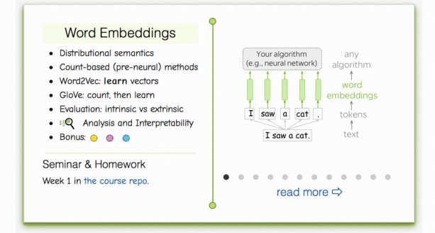
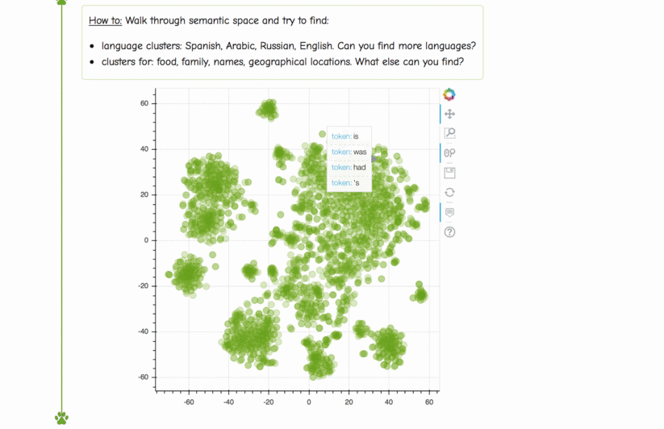
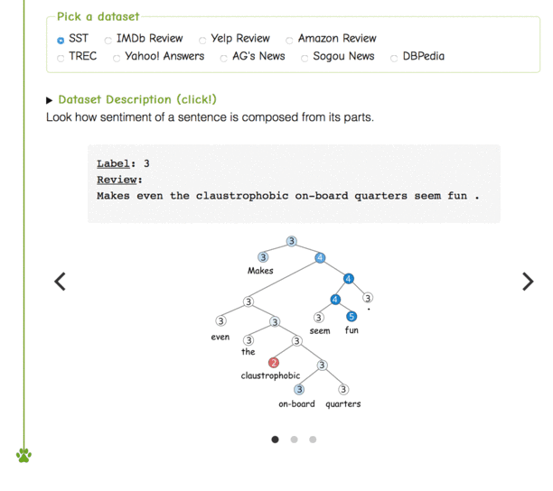

## Неделя 1. Векторные представления слов

### Материалы
- Слайды лекций: [эмбеддинги (Google Drive)](https://drive.google.com/file/d/1y2GKIKBzie7l8iycBO6gTKGiTTfJc4Dr/view) | [классификация (Google Drive)](https://drive.google.com/file/d/1f7vQGNRe1PQi6WnEdCZbtf_zmx6fF8g1/view).
- **Видео на русском:** [лекция и семинар](https://disk.yandex.ru/i/mygl3L-gzgbUfA).
- Материалы других курсов (английский): Stanford CS224N — [введение](https://www.youtube.com/watch?v=OQQ-W_63UgQ), [эмбеддинги](https://www.youtube.com/watch?v=rmVRLeJRkl4), [классификация текстов](https://www.youtube.com/watch?v=nzSPZyjGlWI).

### Практика
Задания этой недели выполняются в Jupyter Notebook. Откройте соответствующий файл и следуйте инструкциям внутри.
- Семинар: [`seminar.ipynb`](./seminar.ipynb) · [Открыть в Colab](https://colab.research.google.com/github/yandexdataschool/nlp_course/blob/2026/week01_embeddings/seminar.ipynb).
- Домашнее задание: [`homework.ipynb`](./homework.ipynb).
- **Для зачисленных студентов:** отправьте оба файла, `seminar.ipynb` и `homework.ipynb`, в LMS, чтобы получить все баллы.

### Интерактивные объяснения, исследовательские упражнения, статьи
- [NLP Course For You: векторные представления слов](https://lena-voita.github.io/nlp_course.html#preview_word_emb).
- [NLP Course For You: классификация текстов](https://lena-voita.github.io/nlp_course.html#preview_text_clf).

### Прогулка по семантическому пространству
- [Интерактивное исследование семантического пространства](https://lena-voita.github.io/nlp_course/word_embeddings.html#analysis_interpretability).

### Просмотр примеров из набора данных
- [Интерактивный просмотр датасета для классификации текста](https://lena-voita.github.io/nlp_course/text_classification.html#dataset_examples).

### Дополнительные материалы
- [Иерархический softmax и sampled softmax для Word2Vec](http://ruder.io/word-embeddings-softmax/).
- [Альтернативное объяснение negative sampling в Word2Vec](https://arxiv.org/pdf/1402.3722.pdf).
- [Проект GloVe](https://nlp.stanford.edu/projects/glove/).
- [Проект fastText](https://github.com/facebookresearch/fastText).
- [Статья Colah о свёртках, в том числе текстовых](http://colah.github.io/posts/2014-07-Understanding-Convolutions/).
- [Применение аналогичных архитектур к музыке](http://benanne.github.io/2014/08/05/spotify-cnns.html).
