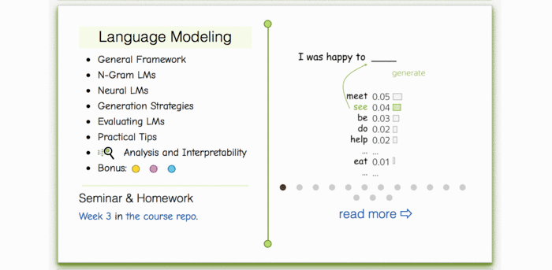

## Неделя 2. Языковые модели

### Материалы
- [Слайды лекции](./lecture_lm.pdf) ([Google Slides](https://docs.google.com/presentation/d/16CTpXAYwIiVuv8nbe729C4_olGYwilhH/edit)).
- **Видео на русском:** [лекция](https://disk.yandex.ru/i/E4NlokgRT6Ci6g), [семинар](https://disk.yandex.ru/i/mSewi0SUky5h6g).
- Материалы других курсов (английский): Stanford NLP — [N-граммные языковые модели](https://archive.org/details/41IntroductionToNGramsStanfordNLPProfessorDanJurafskyChrisManning/), [нейросетевые языковые модели](https://www.youtube.com/watch?v=Keqep_PKrY8).

### Практика
- Семинар: [`seminar.ipynb`](./seminar.ipynb) · [Colab](https://colab.research.google.com/github/yandexdataschool/nlp_course/blob/2026/week02_lm/seminar.ipynb).
- Домашнее задание: [`homework_pytorch.ipynb`](./homework_pytorch.ipynb).

### Дополнительные интерактивные материалы
- [Интерактивный урок по языковым моделям](https://lena-voita.github.io/nlp_course.html#preview_lang_models).
- [Как температура softmax влияет на генерацию](https://lena-voita.github.io/nlp_course/language_modeling.html#generation_strategies_temperature).

### Дополнительные источники
- [Лекция Андрея Карпаты по RNN (2016)](https://www.youtube.com/watch?v=iX5V1WpxxkY), на английском.
- [Подробная лекция Йошуа Бенжио (2016)](https://www.youtube.com/watch?v=xK-bzjIQkmM).
- [Andrej Karpathy: The Unreasonable Effectiveness of Recurrent Neural Networks](http://karpathy.github.io/2015/05/21/rnn-effectiveness/).
- [Christopher Olah: Understanding LSTM Networks](http://colah.github.io/posts/2015-08-Understanding-LSTMs/).
- [Подборка материалов Awesome RNNs](https://github.com/kjw0612/awesome-rnn).
