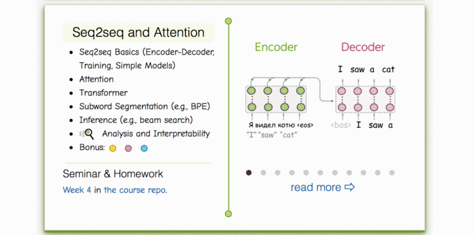

## Неделя 3. Seq2seq и механизм внимания

### Материалы
- [Слайды лекции](./lecture_slides.pdf) ([Google Slides](https://docs.google.com/presentation/d/1IIsYCJF23xokGtL6O1KPxEPNJ1lDSZNz/edit?usp=sharing&ouid=114346045969351679204&rtpof=true&sd=true)).
- **Видео на русском:** [лекция](https://disk.yandex.ru/i/rnbScV8x5QQY6Q), [семинар](https://disk.yandex.ru/i/q4Aew2gHn-BHGw).
- Материалы других курсов (английский): Stanford — [Seq2seq и машинный перевод](https://www.youtube.com/watch?v=IxQtK2SjWWM); CMU — [Seq2seq](https://www.youtube.com/watch?v=aHkgjfKvIhk&list=PL8PYTP1V4I8Ba7-rY4FoB4-jfuJ7VDKEE&index=20), [Attention](https://www.youtube.com/watch?v=ullLRKZ99qQ&index=21&list=PL8PYTP1V4I8Ba7-rY4FoB4-jfuJ7VDKEE).

### Практика
На этой неделе семинар и домашнее задание объединены в один ноутбук.
- [`practice_and_homework.ipynb`](./practice_and_homework.ipynb) · [Colab](https://colab.research.google.com/github/yandexdataschool/nlp_course/blob/2026/week03_attention/practice_and_homework.ipynb).

### Интерактивные материалы
- [Seq2seq и внимание: интерактивный курс](https://lena-voita.github.io/nlp_course.html#preview_seq2seq_attn).

### Дополнительные источники
- [Distill.pub: Attention и модификации RNN](https://distill.pub/2016/augmented-rnns/).
- [Лекция по Seq2seq](https://www.youtube.com/watch?v=G5RY_SUJih4).
- Статьи о метриках [BLEU](http://www.aclweb.org/anthology/P02-1040.pdf) и [CIDEr](https://arxiv.org/pdf/1411.5726.pdf).
- Генерация описаний изображений: [конкурс MSCOCO](http://mscoco.org/dataset/#captions-challenge2015), [пример ноутбука](https://github.com/yandexdataschool/Practical_DL/tree/fall18/week07_seq2seq).
- [The Illustrated Transformer — наглядное объяснение трансформера](https://jalammar.github.io/illustrated-transformer/).
